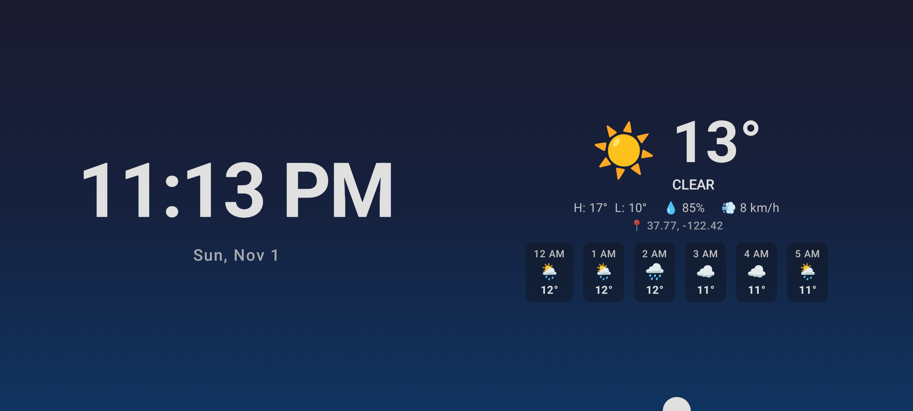
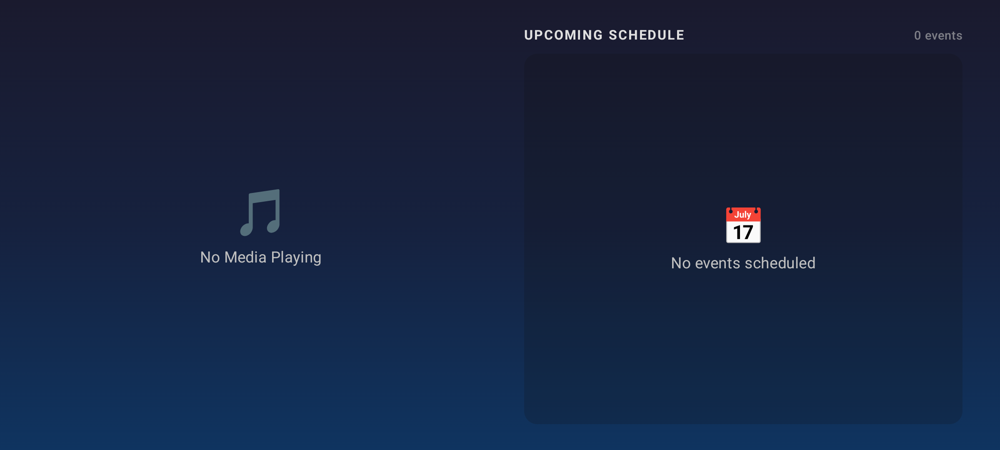
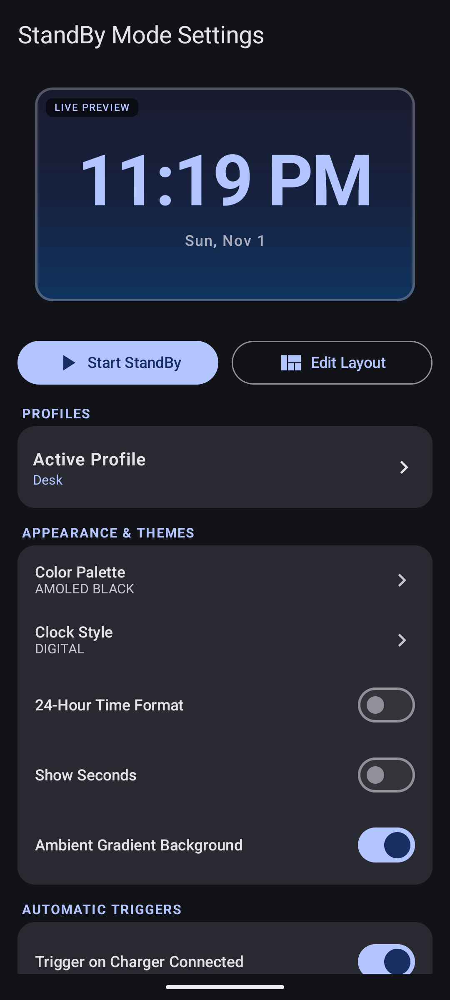
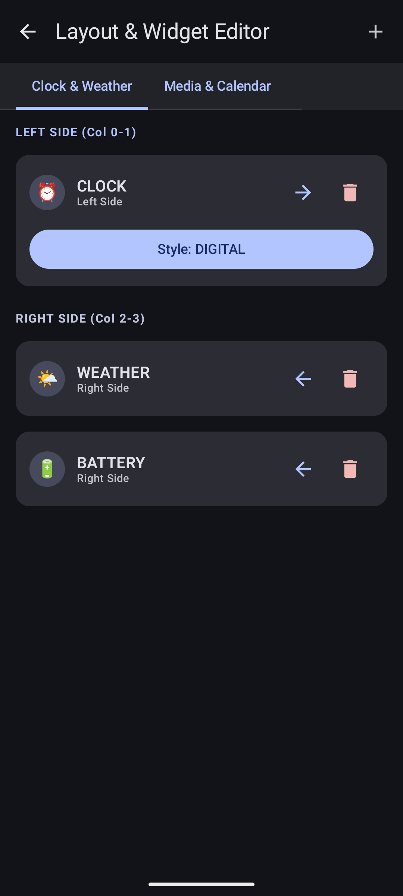
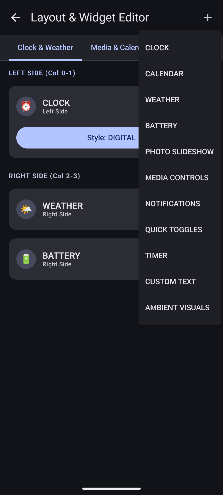

# Standby-Droiddesk

[](https://github.com/SimpleGamez/Standby-Droiddesk)
[-green.svg)](https://developer.android.com)
[](https://kotlinlang.org)
[](https://developer.android.com/jetpack/compose)

A production-grade, full-screen, glanceable always-on display for Android written 100% in native **Kotlin** and **Jetpack Compose (Material 3)**.

Designed for when the phone is docked and charging (e.g., on a nightstand, desk wireless charger, or car mount), transforming the device into an elegant, customizable smart display—similar in spirit to iOS StandBy.

---

## Screenshots

### Full-Screen Standby Display (Landscape)
| Page 1: Clock & Live Open-Meteo Weather | Page 2: Media Controls & Calendar Schedule |
|:---:|:---:|
|  |  |

### Settings & Customization
| Settings & Live Preview Pane | Interactive Layout & Widget Editor | Widget Picker Library |
|:---:|:---:|:---:|
|  |  |  |

---

## Architecture Overview

```mermaid
graph TD
    subgraph UI["UI Layer (Jetpack Compose / Material 3)"]
        A[StandbyActivity] --> B[StandbyScreenHost]
        C[StandbyDreamService] --> B
        D[MainActivity / SettingsActivity] --> E[SettingsNavHost]
        B --> F[HorizontalPager]
        F --> G[ClockModule - 8 Styles]
        F --> H[WeatherModule - Open-Meteo]
        F --> I[BatteryModule - Watts & Time]
        F --> J[MediaControlsModule - Active Session]
        F --> K[CalendarModule - Upcoming Events]
        F --> L[PhotoSlideshowModule - SAF + Ken Burns]
        F --> M[NotificationsModule - Privacy Mode]
        F --> N[QuickTogglesModule - Quick Actions]
        F --> O[TimerModule - Timer / Stopwatch / Alarm]
        F --> P[CustomTextModule / AmbientVisuals]
    end

    subgraph Service["Service Layer & Background Management"]
        Q[StandbyForegroundService] --> R[WakeLock & Notification]
        S[PowerConnectionReceiver] --> T[Auto-Trigger Logic]
        U[StandbyTileService] --> V[Quick Settings Tile]
        W[StandbyNotificationListenerService] --> X[Media & Notification Stream]
    end

    subgraph Domain["Domain Layer"]
        Y[TriggerManager]
        Z[BrightnessController]
        AA[AccelerometerListener]
    end

    subgraph Data["Data Layer"]
        AB[SettingsRepository - DataStore Preferences]
        AC[ProfileRepository - Room Database]
        AD[WeatherRepository - Open-Meteo REST Client]
        AE[CalendarRepository - CalendarContract]
    end

    B --> Y
    B --> Z
    Y --> AB
    Y --> AC
    Q --> AB
    S --> Y
```



---

## Key Features

### 1. Dual Integration Engine: Native DreamService & Activity Fallback
- **System Daydream (DreamService)**: Fully registered screen saver that integrates natively into Android's system display settings (`Settings -> Display -> Screen saver`).
- **Foreground Activity Fallback**: Auto-launches via `ACTION_POWER_CONNECTED` with `setShowWhenLocked(true)`, `setTurnScreenOn(true)`, and sticky immersive full-screen flags.
- **Quick Settings Tile**: Instant one-tap manual launch/stop toggle from the notification shade.

### 2. Multi-Condition Smart Triggers (Independently Toggleable)
- **On Charger Connected**: Triggers automatically as soon as plugged in.
- **Charging + Landscape**: Only launches when tilted sideways on a stand.
- **Charging + Screen Locked**: Activates unobtrusively when docked and locked.
- **Charging + Stationary (Accelerometer)**: Detects when placed securely on a stand/dock without moving.
- **Exit on Unplug**: Gracefully returns to the launcher or locks screen upon disconnect.

### 3. Display Modules (11 Built-in Widgets)
1. **Clock**: 8 distinct styles:
   - `DIGITAL`: High-contrast large format with date.
   - `ANALOG`: Smooth vector clock dial with hour, minute, and second ticks.
   - `FLIP`: Retro split-flap flip card digits.
   - `MINIMAL`: Ultra-thin typography for distraction-free viewing.
   - `BOLD`: Extra-heavy font for glanceability across the room.
   - `WORD_CLOCK`: Conversational time ("IT IS TEN FORTY-FIVE").
   - `BINARY`: 6-column BCD binary glowing dot matrix.
   - `VERTICAL_STACK`: Stacked modern lock-screen style numerals.
2. **Weather**: Live weather via Open-Meteo (zero API keys required), current conditions, highs/lows, humidity, wind, and hourly forecast strip.
3. **Battery & Charging**: Real-time charging wattage (W), battery temperature, charging type (AC, USB, Wireless), and estimated time to full.
4. **Media Controls**: Live album art, track title, artist, seek bar, and transport controls powered by `MediaSessionManager`.
5. **Calendar**: Next 3–5 events from Google/device calendar with start/end times and calendar color badges.
6. **Photo Slideshow**: Ambient photo frame from Storage Access Framework (SAF) folder with smooth crossfades and subtle Ken Burns pan/zoom.
7. **Notifications Glance**: Real-time notification feed with privacy mode to hide sensitive contents.
8. **Quick Toggles & Smart Home**: Wi-Fi, Bluetooth, Flashlight, DND, plus a Matter/Home Assistant integration interface.
9. **Timer / Stopwatch / Next Alarm**: Interactive countdown timer, millisecond stopwatch, and alarm preview.
10. **Custom Text & Quote Widget**: User-customizable quotes with elegant typography.
11. **Ambient Visuals**: Animated gradient canvas with floating starry particles for calm ambient lighting.

### 4. Customization & Layout Editor
- **Live Preview Pane**: Interactive preview directly inside the settings editor.
- **Themes & Palettes**: Material You Dynamic Color, AMOLED Pure Black, Sunset, Ocean, Forest, and Ambient Gradients.
- **Burn-In Protection**: Subtle periodic pixel shifting (random ±dp drift), floating animations, inactivity auto-dimming, and scheduled night mode (red-shift / ultra-dim).
- **Profiles**: Switch between presets ("Desk", "Bedside", "Car") with distinct widgets and trigger rules.
- **Backup & Restore**: Export all layouts and preferences to a portable JSON file.

---

## Permissions & Rationale

| Permission | Purpose | Required? |
|---|---|---|
| `POST_NOTIFICATIONS` | Ongoing foreground service notification so Android doesn't kill the display service while docked | Required (Android 13+) |
| `FOREGROUND_SERVICE_SPECIAL_USE` | Keeps active display alive in modern background restriction environments | Required (Android 14+) |
| `WAKE_LOCK` | Keeps the screen illuminated while docked and charging | Required |
| `RECEIVE_BOOT_COMPLETED` | Re-establishes power broadcast listeners after device reboot | Required |
| `READ_CALENDAR` | Displays upcoming schedule on the Calendar module | Optional |
| `READ_MEDIA_IMAGES` / `READ_EXTERNAL_STORAGE` | Displays local photos in the slideshow widget | Optional |
| `BIND_NOTIFICATION_LISTENER_SERVICE` | Retrieves now-playing music metadata and incoming notification summaries | Optional |
| `REQUEST_IGNORE_BATTERY_OPTIMIZATIONS` | Whitelists app against aggressive OEM battery killer daemons | Recommended |

---

## Setup & Compilation

### Requirements
- **JDK 17 or JDK 21**
- **Android SDK Platform 35**
- **Android Gradle Plugin 8.7.3**

### Clone & Build
```bash
git clone https://github.com/SimpleGamez/Standby-Droiddesk.git
cd Standby-Droiddesk
```

To compile the debug APK:
```bash
./gradlew assembleDebug
```

To build a signed, optimized release APK:
```bash
./gradlew assembleRelease
# Output: release/Standby-Droiddesk-v1.0.0.apk (or app/build/outputs/apk/release/app-release.apk)
```

To run unit tests:
```bash
./gradlew testDebugUnitTest
```

---

## Testing on Android Emulator

1. **Launch an Android Emulator** (API 26 to 35, preferably a tablet or phone in landscape).
2. **Simulate Charging**:
   Open the emulator Extended Controls (`...` on the sidebar) -> **Battery**:
   - Set **Charger connection** to `AC Charger`.
   - Set **Battery status** to `Charging`.
3. **Simulate Landscape Orientation**:
   Rotate the emulator using `Ctrl + Left/Right` (or `Cmd + Left/Right` on macOS).
4. **Test Native DreamService (Daydream)**:
   - Go to Android system **Settings -> Display -> Screen saver**.
   - Select **Standby Droiddesk**.
   - Tap **Start now** to see the native DreamService in action.
5. **Test Quick Settings Tile**:
   - Pull down the notification shade twice.
   - Tap the pencil/edit icon and drag the **Standby Droiddesk** tile to your active tiles.
   - Tap the **Standby Droiddesk** tile to toggle standby mode on and off.

